# Helpdesk AI

Helpdesk AI helps small businesses turn scattered customer requests into tracked tickets. Every new ticket is assigned to a Staff member automatically, and AI helps at four points: it classifies new tickets (category, priority, sentiment), summarizes long tickets for Staff, polishes Staff replies before they are sent, and suggests replies grounded in the shop's own policies, citing them. AI never blocks ticket creation and never sends anything to a customer by itself. Customers get an email when Staff reply to their ticket or change its status; the conversation itself stays on the website.

Helpdesk AI is a **customer service** help desk (tickets come from external customers), not an internal IT service desk. Examples, wireframes, and sample data use one sample domain: **a small online shop**.

## 1. Requirements — INVEST, Use Cases, and Acceptance Criteria

Requirements define what Helpdesk AI must do, who uses it, the value delivered, and the observable conditions of success. User stories are reviewed with INVEST and mapped to use cases, business rules, and acceptance criteria.

### 1.1 Product mind map

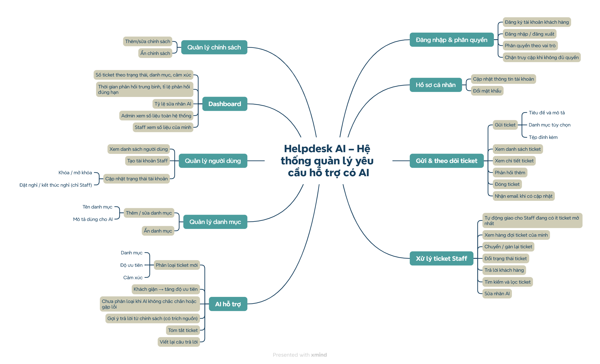

### 1.2 INVEST requirements

The MVP backlog includes 41 user stories. They cover registration and login, customer tickets, automatic assignment, AI classification, ticket handling with AI summary and rewrite, categories, users (including Staff on leave), dashboards, email notifications to customers, and policy articles that ground cited reply suggestions. Before a user story is ready for development, it is checked using the INVEST criteria.

| Criterion | Meaning in Helpdesk AI |
|---|---|
| **Independent** | Each story delivers one clear outcome and depends on other stories only when necessary (login, ticket creation, categories). |
| **Negotiable** | The UI and technical implementation can change as long as the outcome, permissions, and AI guardrails stay the same. |
| **Valuable** | Each story gives value to the Customer, Staff, Administrator, or the business. |
| **Estimable** | Roles, inputs, limits, dependencies, and failure cases (including AI failure) are documented, and every story has a size. |
| **Small** | Each story covers one capability; AI classification is split into the main classification, the angry rule, and the fallback. |
| **Testable** | Every story has Given/When/Then acceptance criteria with concrete values. |

```text
US-01–US-04   Authentication and authorization
US-05–US-06   Personal profile
US-07–US-12   Submit and track tickets (Customer)
US-13–US-16   Automatic assignment and AI classification (system behaviour)
US-17–US-26   Ticket handling with AI summary and rewrite (Staff, Administrator)
US-27–US-29   Category management
US-30–US-32   User management
US-33–US-34   Dashboard
US-35         Email notification of ticket updates (Customer)
US-36         Set Staff on leave (Administrator)
US-37–US-39   Policy articles (Administrator)
US-40–US-41   Reply suggestion from policies (Staff, Administrator)
```

Stories are prioritized with MoSCoW: 22 Must, 19 Should, 0 Could, and 7 Won't (out of scope). The complete backlog and per-story INVEST review are maintained in [User Stories (INVEST)](docs/02-usecases-userstories/03-user-stories-invest.md), the Given/When/Then criteria in [Acceptance Criteria](docs/02-usecases-userstories/04-acceptance-criteria.md), and the priorities in [MoSCoW Prioritization](docs/02-usecases-userstories/05-moscow-prioritization.md).

### 1.3 Use cases

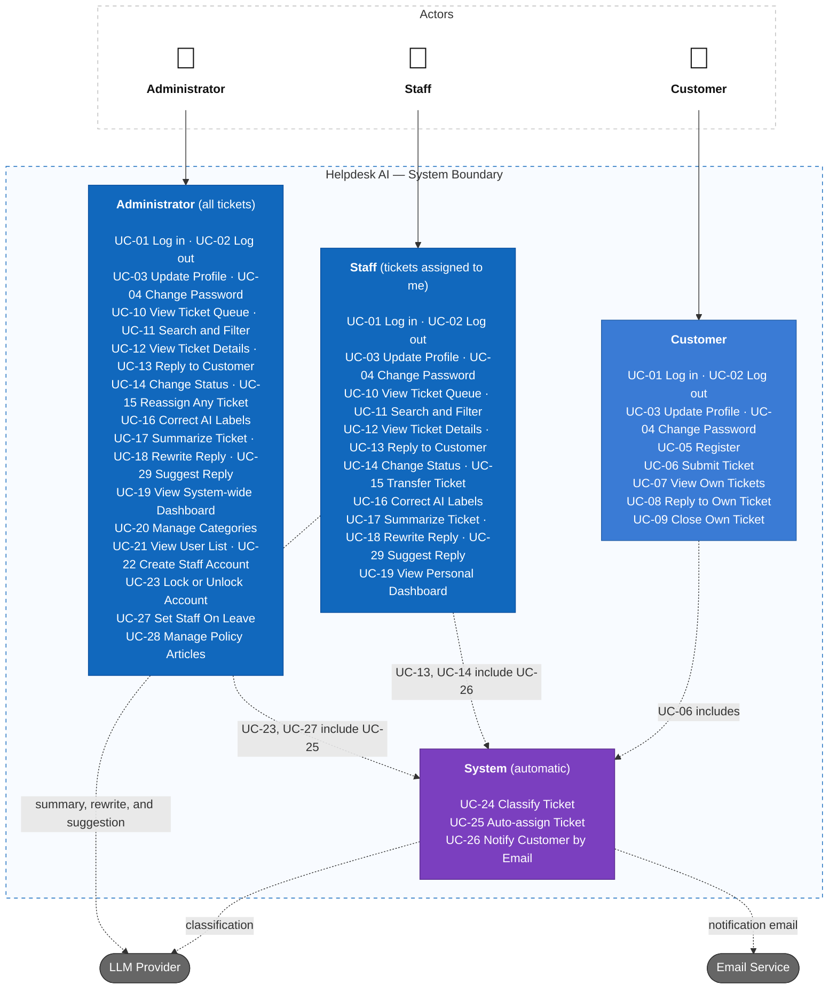

For detailed actors and the use case diagram, see [Actors and Use Cases](docs/02-usecases-userstories/01-use-cases.md); for business flows, see [Use Case Specifications](docs/02-usecases-userstories/02-use-case-specifications.md).

### 1.4 Roles and permissions

| Capability | Customer | Staff | Administrator |
|---|---|---|---|
| Register a customer account | Yes | No | No |
| Log in, log out, update profile, change password | Yes | Yes | Yes |
| Submit tickets, reply, close own tickets | Own tickets | No | No |
| Receive an email when Staff reply or change the status | Own tickets | No | No |
| View ticket queue and details | No | Assigned to me | All tickets |
| Reply, change status, correct AI labels | No | Assigned to me | All tickets |
| AI summary, AI reply rewrite, and AI reply suggestion | No | Assigned to me | All tickets |
| Transfer / reassign tickets | No | Transfer own | Reassign any |
| See priority, sentiment, confidence, AI reason | No | Yes | Yes |
| Dashboard | No | Personal | System-wide |
| Manage categories | No | No | Yes |
| Manage users (create Staff, lock/unlock) | No | No | Yes |
| Manage policy articles | No | No | Yes |
| Set Staff on leave or back | No | No (not even themselves) | Yes |

New tickets are auto-assigned to the active Staff member with the fewest open tickets; Staff on leave or locked are skipped, and for the first 4 hours after a Staff account is created, comes back from leave, or is unlocked, that Staff member gets a fair share of new tickets instead of all of them. The backend must enforce role and assignment rules; hiding frontend controls serves UI/UX only. See [Business rules](docs/requirements/business-rules.md).

## 2. Information Architecture, Screen Hierarchy, and UI/UX

The information architecture groups screens into four areas by the roles that use them. Each screen card lists only its main content. Screen permissions and navigation follow the role matrix, and loading, empty, error, and AI states are defined consistently.

### 2.1 Information architecture

Solid lines connect a parent screen to a child screen; dashed arrows show which areas each actor uses. The purple card is the screen with AI features.

```mermaid
flowchart TB
    customer["<span style='font-size:40px'>👤</span><br/><b>Customer</b>"]
    staff["<span style='font-size:40px'>👤</span><br/><b>Staff</b>"]
    admin["<span style='font-size:40px'>👤</span><br/><b>Administrator</b>"]

    subgraph portal["Customer portal"]
        direction TB
        register["<b>SCR-02 Register</b><br/>• Full name, email, phone<br/>• Password + confirmation"]
        myTickets["<b>SCR-10 My Tickets</b><br/>• Ticket list + status<br/>• Filter by status<br/>• Submit a ticket"]
        submit["<b>SCR-11 Submit Ticket</b><br/>• Title, description<br/>• Category (optional)<br/>• Attachments"]
        custDetail["<b>SCR-12 Ticket Detail</b><br/>• Conversation<br/>• Reply box<br/>• Close ticket"]
        myTickets --- submit
        myTickets --- custDetail
    end

    subgraph account["Account (all roles)"]
        direction TB
        login["<b>SCR-01 Login</b><br/>• Email, password<br/>• Link to Register"]
        profile["<b>SCR-40 Profile</b><br/>• Full name, phone<br/>• Change password"]
    end

    subgraph workspace["Ticket workspace (Staff: own tickets · Admin: all)"]
        direction TB
        queue["<b>SCR-20 Ticket Queue</b><br/>• Tickets by urgency<br/>• AI labels, Unclassified badge<br/>• Search and filters"]
        handling["<b>SCR-21 Ticket Handling</b><br/>• Conversation<br/>• AI label panel + edit<br/>• AI summary<br/>• Reply box + AI rewrite<br/>• AI reply suggestion with citations<br/>• Status, transfer"]
        dashboard["<b>SCR-22 Dashboard</b><br/>• Tickets by status, category, sentiment<br/>• Avg first response time<br/>• AI label correction rate"]
        queue --- handling
    end

    subgraph administration["Administration (Admin only)"]
        direction TB
        categories["<b>SCR-30 Categories</b><br/>• Category list<br/>• Add / edit (description for AI)<br/>• Hide / show"]
        policies["<b>SCR-36 Policies</b><br/>• Policy articles + review status<br/>• Add / edit, mark reviewed<br/>• Hide / show"]
        users["<b>SCR-31 Users</b><br/>• User list + filters<br/>• Create Staff<br/>• Lock / unlock<br/>• Staff on leave / back"]
    end

    customer -.-> portal
    customer -.-> account
    staff -.-> account
    staff -.-> workspace
    admin -.-> account
    admin -.-> workspace
    admin -.-> administration

    classDef actor fill:none,stroke:none,color:#111
    classDef screen fill:#fff,color:#111,stroke:#1168bd,text-align:left
    classDef ai fill:#f3ecfb,color:#111,stroke:#7b3fbf,text-align:left
    class customer,staff,admin actor
    class login,register,profile,myTickets,submit,custDetail,queue,dashboard,categories,users,policies screen
    class handling ai
```

### 2.2 Screen hierarchy

Login takes each role to its home page: Customer → My Tickets, Staff → Ticket Queue (own tickets), Administrator → Dashboard. Lists open full detail pages (My Tickets → Ticket Detail; Ticket Queue → Ticket Handling). Create, edit, transfer, and confirmation dialogs are modals owned by their page. Unauthorized navigation shows the Access denied page.

Source: [Sitemap by Role](docs/03-information-architecture/01-sitemap.md). Screen IDs are listed in [Screen Inventory](docs/03-information-architecture/04-screen-inventory.md), navigation in [Navigation](docs/03-information-architecture/03-navigation.md), user flows in [Primary User Flows](docs/03-information-architecture/05-user-flows.md), and UI and AI states in [UI/UX States and Accessibility](docs/03-information-architecture/06-ui-states-and-accessibility.md).

### 2.3 UI wireframes

High-fidelity wireframes in static HTML (Vietnamese UI copy, fictional sample shop "Lá Cọ Home"). AI suggestions are drawn as **dashed violet** and marked "AI"; anything a person confirmed or corrected is **solid**. Only the three core branches are shown here. Every screen and state is in the wireframe gallery: open `docs/04-uiux/wireframes/index.html` in a browser from a local clone (GitHub shows `.html` files as source code).

#### Submit & track tickets (Customer)

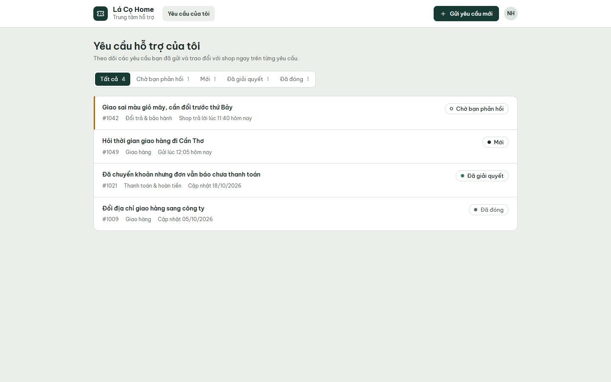

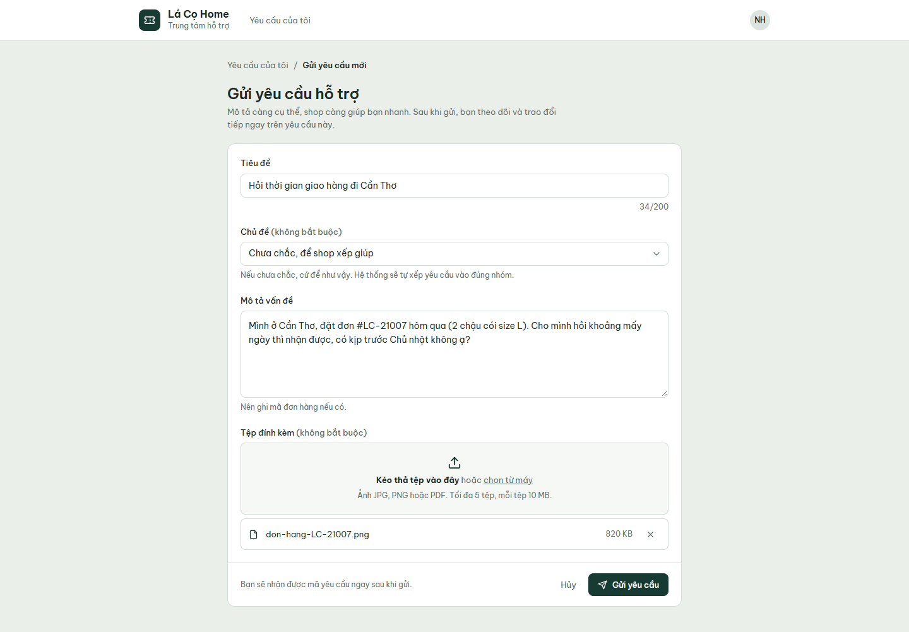

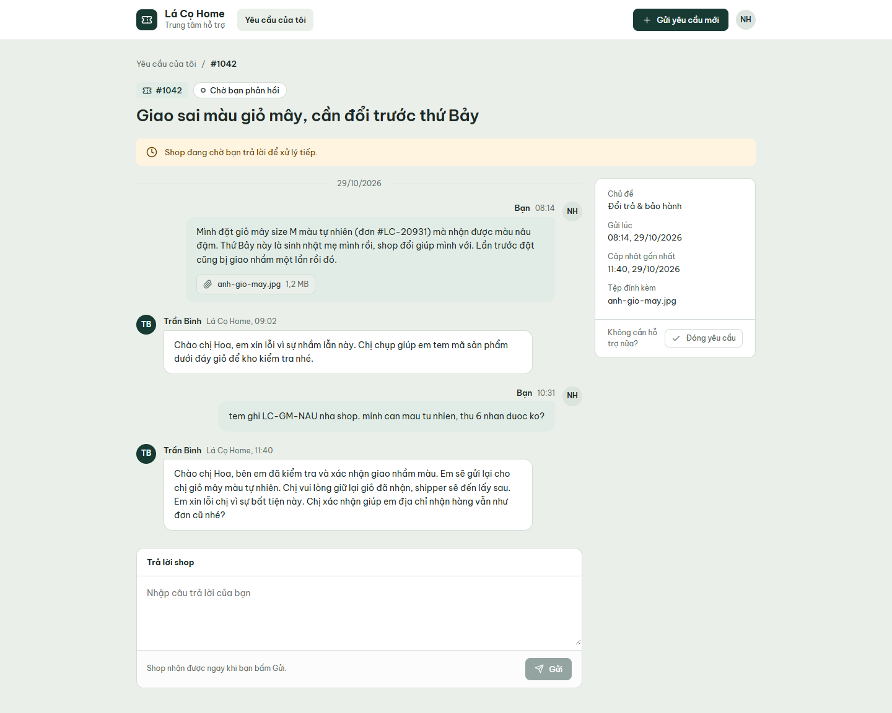

#### Ticket handling (Staff)

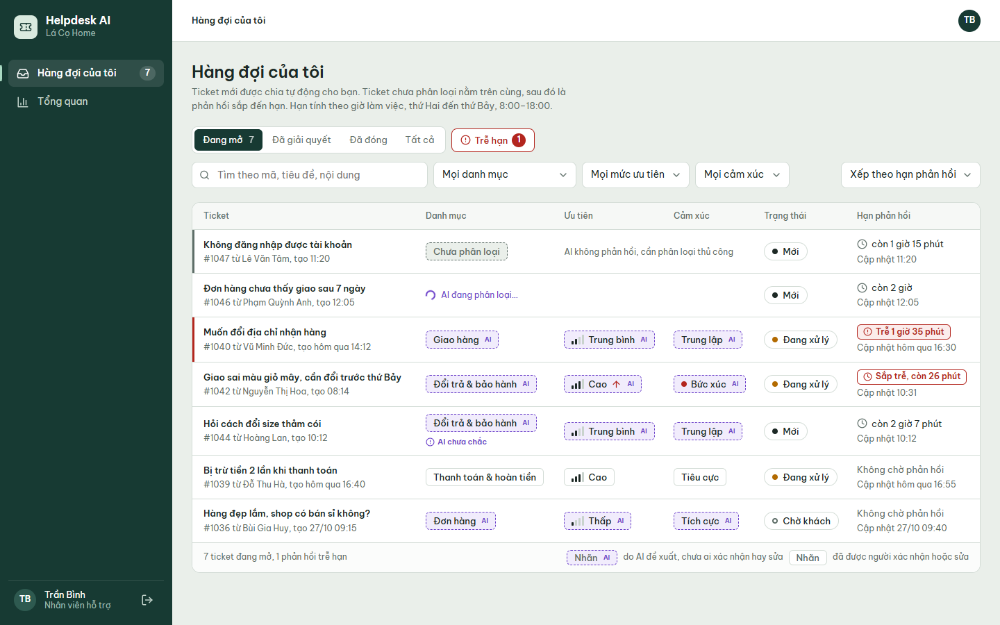

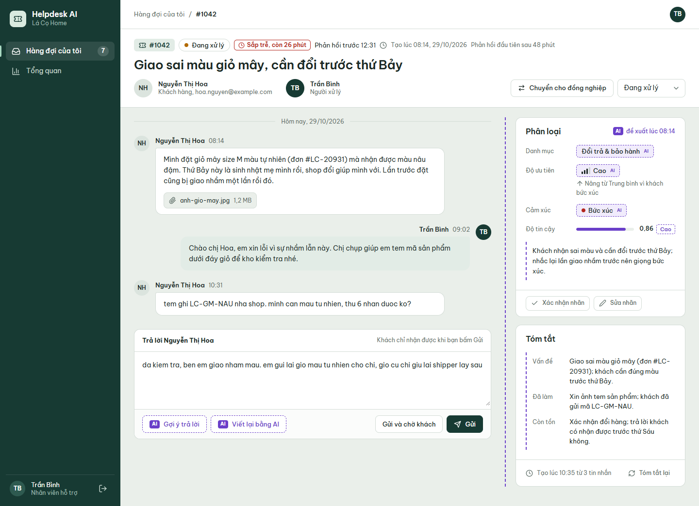

#### AI assistance

Fallback to "Unclassified" when AI fails, so Staff triage manually:

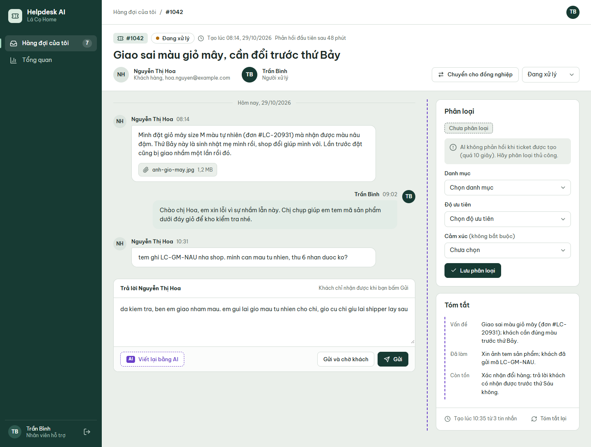

Reply rewrite shown beside the draft; nothing is sent until Staff click Send:

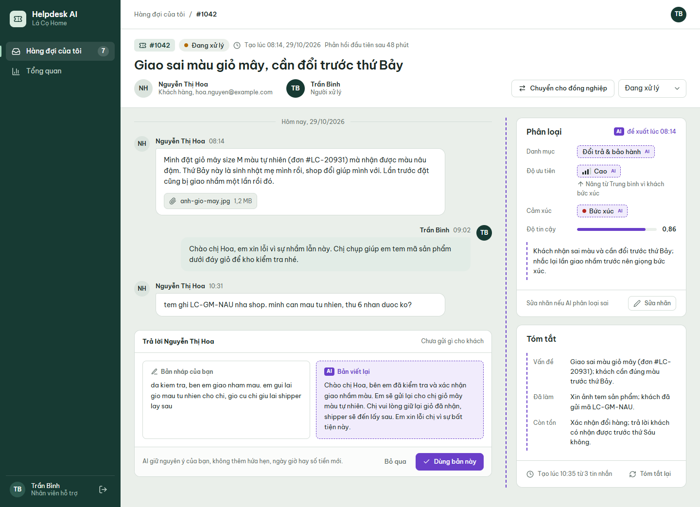

Reply suggestion grounded in the shop's policies, with the cited passages; the customer asked about Friday, but no policy promises a date, so neither does the suggestion:

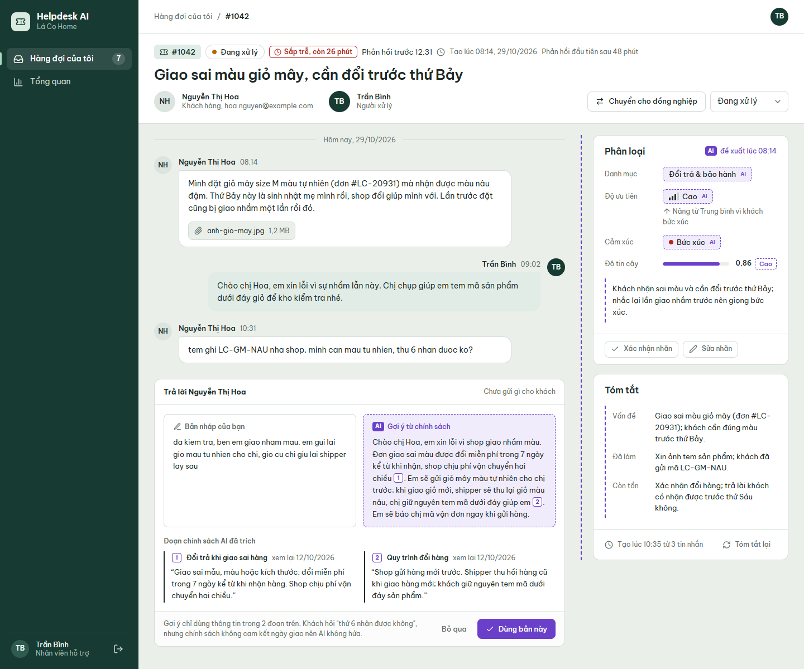

Summary marked outdated after a new message:

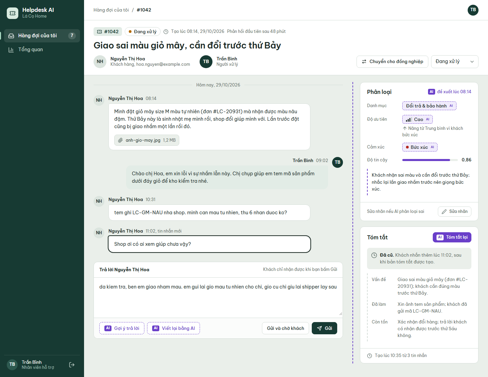

Source: [Screen notes and states](docs/04-uiux/02-screen-notes.md) and [Design system](docs/04-uiux/01-design-system.md).

## Documentation

- Research: [Context and problem](docs/01-research/01-context-and-problem.md), [Goals and metrics](docs/01-research/02-goals-and-metrics.md), [Stakeholders](docs/01-research/03-stakeholders.md), [Similar products](docs/01-research/04-similar-products.md), [MVP scope](docs/01-research/05-scope.md), [Risks](docs/01-research/06-risks.md), [AI vs rule-based](docs/01-research/07-ai-vs-rule-based.md), [Glossary](docs/01-research/08-glossary.md), [Decisions](docs/01-research/00-decisions.md), [Future work](docs/01-research/09-future-work.md).
- Requirements: [Actors and use cases](docs/02-usecases-userstories/01-use-cases.md), [Use case specifications](docs/02-usecases-userstories/02-use-case-specifications.md), [User stories (INVEST)](docs/02-usecases-userstories/03-user-stories-invest.md), [Acceptance criteria](docs/02-usecases-userstories/04-acceptance-criteria.md), [MoSCoW](docs/02-usecases-userstories/05-moscow-prioritization.md), [Decisions and defaults](docs/02-usecases-userstories/00-decisions.md).
- Requirements catalogs: [Business rules](docs/requirements/business-rules.md).
- UI/UX: [Sitemap](docs/03-information-architecture/01-sitemap.md), [Routes and permissions](docs/03-information-architecture/02-routes-and-permissions.md), [Navigation](docs/03-information-architecture/03-navigation.md), [Screen inventory](docs/03-information-architecture/04-screen-inventory.md), [User flows](docs/03-information-architecture/05-user-flows.md), [UI states and accessibility](docs/03-information-architecture/06-ui-states-and-accessibility.md), [Decisions and defaults](docs/03-information-architecture/00-decisions.md).
- Wireframes: [Wireframe gallery](docs/04-uiux/wireframes/index.html), [Screen notes and states](docs/04-uiux/02-screen-notes.md), [Design system](docs/04-uiux/01-design-system.md), [Decisions and defaults](docs/04-uiux/00-decisions.md).
- Traceability: [Master traceability matrix](docs/traceability/master-traceability.md).

## Project Progress

- [x] Define the problem, measurable goals, stakeholders, and user roles
- [x] Compare similar products, define the MVP scope, risks, and AI vs rule-based reasoning
- [x] Draw the product mind map
- [x] Write the use cases and the use case diagram
- [x] Write user stories following INVEST
- [x] Write acceptance criteria (Given/When/Then) and business rules
- [x] Prioritize the backlog with MoSCoW
- [x] Design the information architecture, sitemap per role, and user flows
- [x] Design the UI/UX wireframes, including AI states (loading, error, Unclassified, outdated summary)
- [ ] Design the ERD (DBML and Mermaid)
- [ ] Write the API documentation in OpenAPI 3.0 and the cross-check report
- [ ] Design the C4 model and choose the tech stack and LLM provider
- [ ] Design the code structure
- [ ] Implement the modules, starting from Auth
