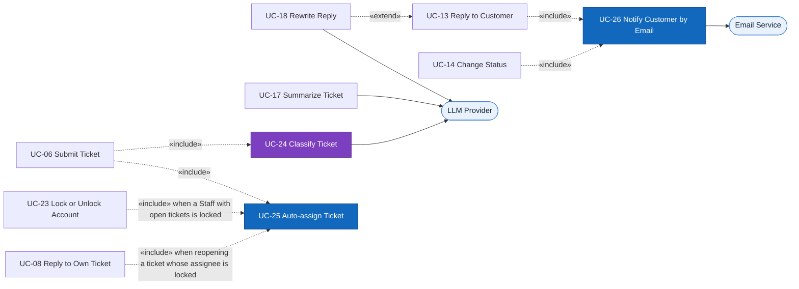

# Actors and Use Cases

> Design status: MVP — Step 2 of 9, approved
>
> Implementation status: NOT STARTED

## Actors and roles

| Role | Display name in UI | Description |
|---|---|---|
| `CUSTOMER` | Customer | External customer of the shop. Registers, submits and tracks own tickets. |
| `STAFF` | Staff | Support employee. Handles the tickets assigned to them. |
| `ADMIN` | Administrator | Everything Staff can do, on **all** tickets, plus administration (D-03). |
| — | LLM Provider | External system called for classification, summary, and rewrite. |
| — | Email Service | External system that delivers notification emails to customers (D-19). |
| — | System | Runs automatic behaviour (classification, auto-assignment, email notification) triggered by other use cases. |

## Role × use case matrix

| Use case | Customer | Staff | Admin |
|---|---|---|---|
| UC-01 Log in, UC-02 Log out | ✓ | ✓ | ✓ |
| UC-03 Update profile, UC-04 Change password | ✓ | ✓ | ✓ |
| UC-05 Register | ✓ (as visitor) | | |
| UC-06 Submit ticket | ✓ | | |
| UC-07 View own tickets | Own | | |
| UC-08 Reply to own ticket | Own | | |
| UC-09 Close own ticket | Own | | |
| UC-10 View ticket queue | | Assigned to me | All tickets |
| UC-11 Search and filter tickets | | Assigned to me | All tickets |
| UC-12 View ticket details | | Assigned to me | All tickets |
| UC-13 Reply to customer | | Assigned to me | All tickets |
| UC-14 Change ticket status | | Assigned to me | All tickets |
| UC-15 Transfer or reassign ticket | | Transfer own | Reassign any |
| UC-16 Correct AI labels | | Assigned to me | All tickets |
| UC-17 Summarize ticket | | Assigned to me | All tickets |
| UC-18 Rewrite reply | | Assigned to me | All tickets |
| UC-19 View dashboard | | Personal | System-wide |
| UC-20 Manage categories | | | ✓ |
| UC-21 View user list | | | ✓ |
| UC-22 Create Staff account | | | ✓ |
| UC-23 Lock or unlock account | | | ✓ |
| UC-24 Classify ticket, UC-25 Auto-assign ticket | System | System | System |
| UC-26 Notify customer by email | Receives the email | System | System |

Menus and buttons are **not displayed** when the user lacks permission. Unauthorized URL access shows an "Access denied" page.

## Use case diagram

Every use case is a separate node, grouped by module inside the system boundary. UC-24, UC-25, and UC-26 have no direct actor; they are triggered by other use cases (see [Included and extending use cases](#included-and-extending-use-cases)).

```mermaid
flowchart LR
    subgraph left["Actors"]
        direction TB
        customer["<span style='font-size:40px'>👤</span><br/><b>Customer</b>"]
    end

    subgraph system["Helpdesk AI — System Boundary"]
        direction TB
        subgraph access["Access and profile"]
            direction LR
            uc01["UC-01 Log in"]
            uc02["UC-02 Log out"]
            uc03["UC-03 Update Profile"]
            uc04["UC-04 Change Password"]
            uc05["UC-05 Register"]
        end
        subgraph customerTickets["Customer tickets"]
            direction LR
            uc06["UC-06 Submit Ticket"]
            uc07["UC-07 View Own Tickets"]
            uc08["UC-08 Reply to Own Ticket"]
            uc09["UC-09 Close Own Ticket"]
        end
        subgraph handling["Ticket handling and AI"]
            direction LR
            uc10["UC-10 View Ticket Queue"]
            uc11["UC-11 Search and Filter"]
            uc12["UC-12 View Ticket Details"]
            uc13["UC-13 Reply to Customer"]
            uc14["UC-14 Change Status"]
            uc15["UC-15 Transfer or Reassign"]
            uc16["UC-16 Correct AI Labels"]
            uc17["UC-17 Summarize Ticket"]
            uc18["UC-18 Rewrite Reply"]
            uc19["UC-19 View Dashboard"]
        end
        subgraph administration["Administration"]
            direction LR
            uc20["UC-20 Manage Categories"]
            uc21["UC-21 View User List"]
            uc22["UC-22 Create Staff Account"]
            uc23["UC-23 Lock or Unlock Account"]
        end
        subgraph automatic["Automatic (System)"]
            direction LR
            uc24["UC-24 Classify Ticket"]
            uc25["UC-25 Auto-assign Ticket"]
            uc26["UC-26 Notify Customer by Email"]
        end
    end

    subgraph right["Actors"]
        direction TB
        staff["<span style='font-size:40px'>👤</span><br/><b>Staff</b>"]
        admin["<span style='font-size:40px'>👤</span><br/><b>Administrator</b>"]
    end

    customer --> uc01 & uc02 & uc03 & uc04 & uc05 & uc06 & uc07 & uc08 & uc09
    staff --> uc01 & uc02 & uc03 & uc04 & uc10 & uc11 & uc12 & uc13 & uc14 & uc15 & uc16 & uc17 & uc18 & uc19
    admin --> uc01 & uc02 & uc03 & uc04 & uc10 & uc11 & uc12 & uc13 & uc14 & uc15 & uc16 & uc17 & uc18 & uc19 & uc20 & uc21 & uc22 & uc23

    classDef actor fill:none,stroke:none,color:#111
    classDef usecase fill:#1168bd,color:#fff,stroke:#0b4f9e
    classDef ai fill:#7b3fbf,color:#fff,stroke:#5a2d8c
    class customer,staff,admin actor
    class uc01,uc02,uc03,uc04,uc05,uc06,uc07,uc08,uc09,uc10,uc11,uc12,uc13,uc14,uc15,uc16,uc19,uc20,uc21,uc22,uc23,uc25,uc26 usecase
    class uc17,uc18,uc24 ai
    style left fill:#fff,stroke:#bbb,stroke-dasharray:5 5
    style right fill:#fff,stroke:#bbb,stroke-dasharray:5 5
    style system fill:#f8fbff,stroke:#1168bd,stroke-dasharray:5 5
```

Purple nodes use the LLM Provider.

### Included and extending use cases

Administrator can perform UC-10..UC-19 on **all** tickets; Staff only on tickets currently assigned to them (D-09).

## Use cases by actor

| Actor | Use cases |
|---|---|
| Customer | UC-01 Log in · UC-02 Log out · UC-03 Update profile · UC-04 Change password · UC-05 Register · UC-06 Submit ticket · UC-07 View own tickets · UC-08 Reply to own ticket · UC-09 Close own ticket |
| Staff | UC-01..UC-04 · UC-10 View ticket queue · UC-11 Search and filter · UC-12 View ticket details · UC-13 Reply to customer · UC-14 Change status · UC-15 Transfer ticket · UC-16 Correct AI labels · UC-17 Summarize ticket · UC-18 Rewrite reply · UC-19 View personal dashboard |
| Administrator | UC-01..UC-04 · UC-10..UC-19 on all tickets (UC-15 = reassign any ticket, UC-19 = system-wide dashboard) · UC-20 Manage categories · UC-21 View user list · UC-22 Create Staff account · UC-23 Lock or unlock account |
| System | UC-24 Classify ticket (with LLM Provider) · UC-25 Auto-assign ticket · UC-26 Notify customer by email (with Email Service) |

**Related:** [Step index](README.md)
