# Sitemap by Role

> Design status: MVP — Step 3 of 9, approved
>
> Implementation status: NOT STARTED

**Notation**
- **Card:** one screen, with its ID and only its main content.
- **Area (box):** a group of screens that the same roles use.
- **Solid line:** parent screen → child screen (where the child is opened from).
- **Dashed arrow:** the actor uses the screens in that area.
- **Purple card:** a screen with AI features.
- Modals, the "Access denied" page, and loading or error states are **not** cards. They are listed in the [screen inventory](04-screen-inventory.md) and the [UI/UX state contract](06-ui-states-and-accessibility.md).

```mermaid
flowchart TB
    customer["<span style='font-size:40px'>👤</span><br/><b>Customer</b>"]
    staff["<span style='font-size:40px'>👤</span><br/><b>Staff</b>"]
    admin["<span style='font-size:40px'>👤</span><br/><b>Administrator</b>"]

    subgraph portal["Customer portal"]
        direction TB
        register["<b>SCR-02 Register</b><br/>• Full name, email, phone<br/>• Password + confirmation"]
        myTickets["<b>SCR-10 My Tickets</b><br/>• Ticket list + status<br/>• Filter by status<br/>• Submit a ticket"]
        submit["<b>SCR-11 Submit Ticket</b><br/>• Title, description<br/>• Category (optional)<br/>• Attachments"]
        custDetail["<b>SCR-12 Ticket Detail</b><br/>• Conversation<br/>• Reply box<br/>• Close ticket"]
        myTickets --- submit
        myTickets --- custDetail
    end

    subgraph account["Account (all roles)"]
        direction TB
        login["<b>SCR-01 Login</b><br/>• Email, password<br/>• Link to Register"]
        profile["<b>SCR-40 Profile</b><br/>• Full name, phone<br/>• Change password"]
    end

    subgraph workspace["Ticket workspace (Staff: own tickets · Admin: all)"]
        direction TB
        queue["<b>SCR-20 Ticket Queue</b><br/>• Tickets by urgency<br/>• AI labels, Unclassified badge<br/>• Search and filters"]
        handling["<b>SCR-21 Ticket Handling</b><br/>• Conversation<br/>• AI label panel + edit<br/>• AI summary<br/>• Reply box + AI rewrite<br/>• Status, transfer"]
        dashboard["<b>SCR-22 Dashboard</b><br/>• Tickets by status, category, sentiment<br/>• Avg first response time<br/>• AI label correction rate"]
        queue --- handling
    end

    subgraph administration["Administration (Admin only)"]
        direction TB
        categories["<b>SCR-30 Categories</b><br/>• Category list<br/>• Add / edit (description for AI)<br/>• Hide / show"]
        users["<b>SCR-31 Users</b><br/>• User list + filters<br/>• Create Staff<br/>• Lock / unlock"]
    end

    customer -.-> portal
    customer -.-> account
    staff -.-> account
    staff -.-> workspace
    admin -.-> account
    admin -.-> workspace
    admin -.-> administration

    classDef actor fill:none,stroke:none,color:#111
    classDef screen fill:#fff,color:#111,stroke:#1168bd,text-align:left
    classDef ai fill:#f3ecfb,color:#111,stroke:#7b3fbf,text-align:left
    class customer,staff,admin actor
    class login,register,profile,myTickets,submit,custDetail,queue,dashboard,categories,users screen
    class handling ai
```

## Screens per role

| Role | Home page (DF-16) | Screens |
|---|---|---|
| Customer | SCR-10 My Tickets | SCR-01, SCR-02, SCR-10, SCR-11, SCR-12, SCR-40 |
| Staff | SCR-20 Ticket Queue (my tickets) | SCR-01, SCR-20, SCR-21, SCR-22 (personal), SCR-40 |
| Administrator | SCR-22 Dashboard (system-wide) | SCR-01, SCR-20 (all tickets), SCR-21, SCR-22, SCR-30, SCR-31, SCR-40 |

**Related:** [Step index](README.md)
