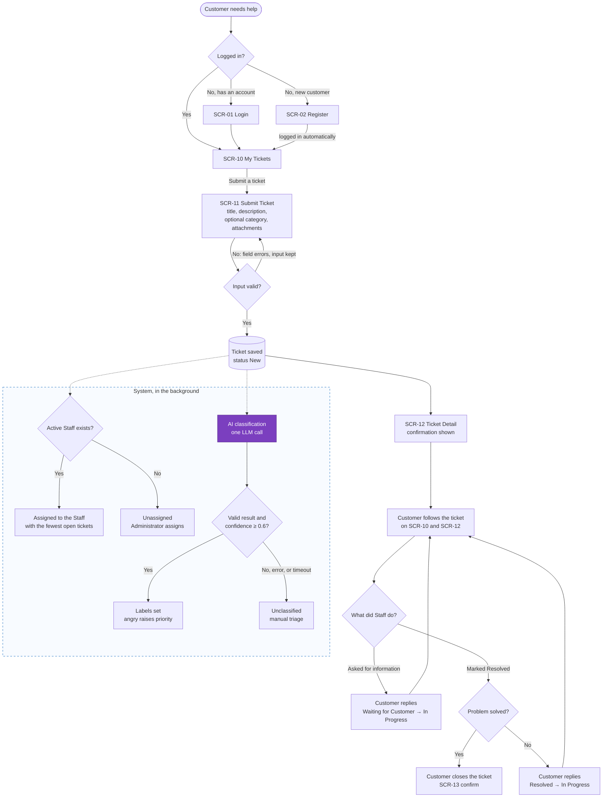
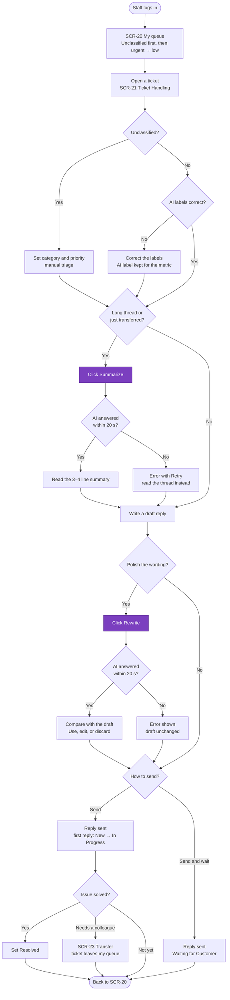

# Primary User Flows

> Design status: MVP — Step 3 of 9, approved
>
> Implementation status: NOT STARTED

## Customer submits a ticket

The customer's path never waits for AI: the ticket is saved and confirmed first, and assignment and classification run in the background (BR-03, BR-08).

## Staff handles a ticket with AI

The three AI features meet here: labels from classification, Summarize, and Rewrite. Every AI step has a failure path that leaves the Staff member able to continue manually.

**Related:** [Step index](README.md)
