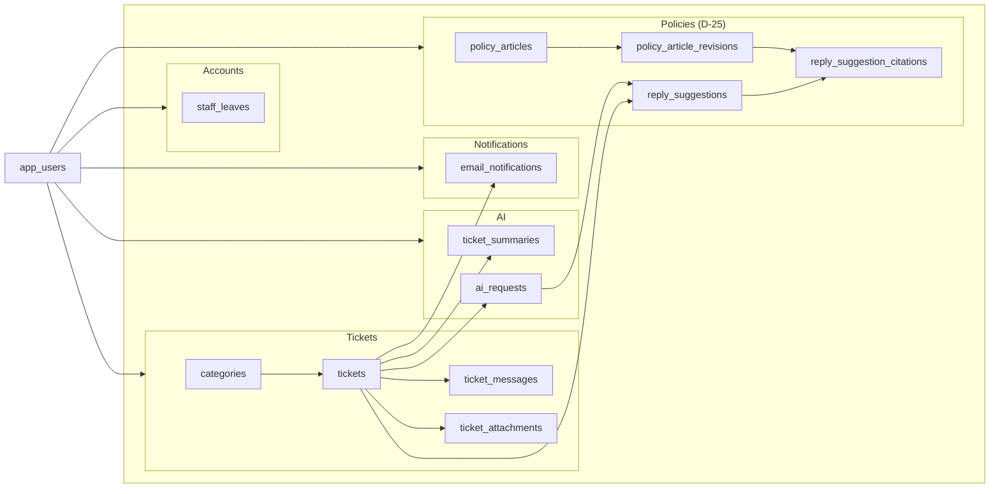
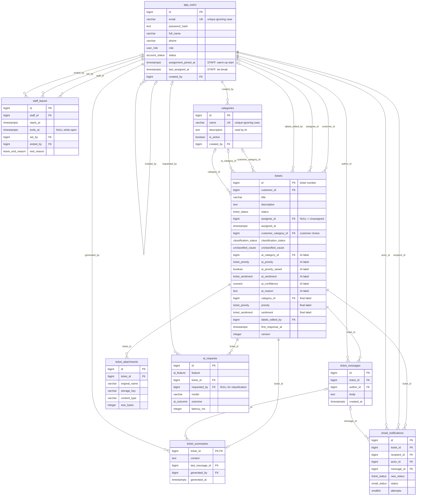
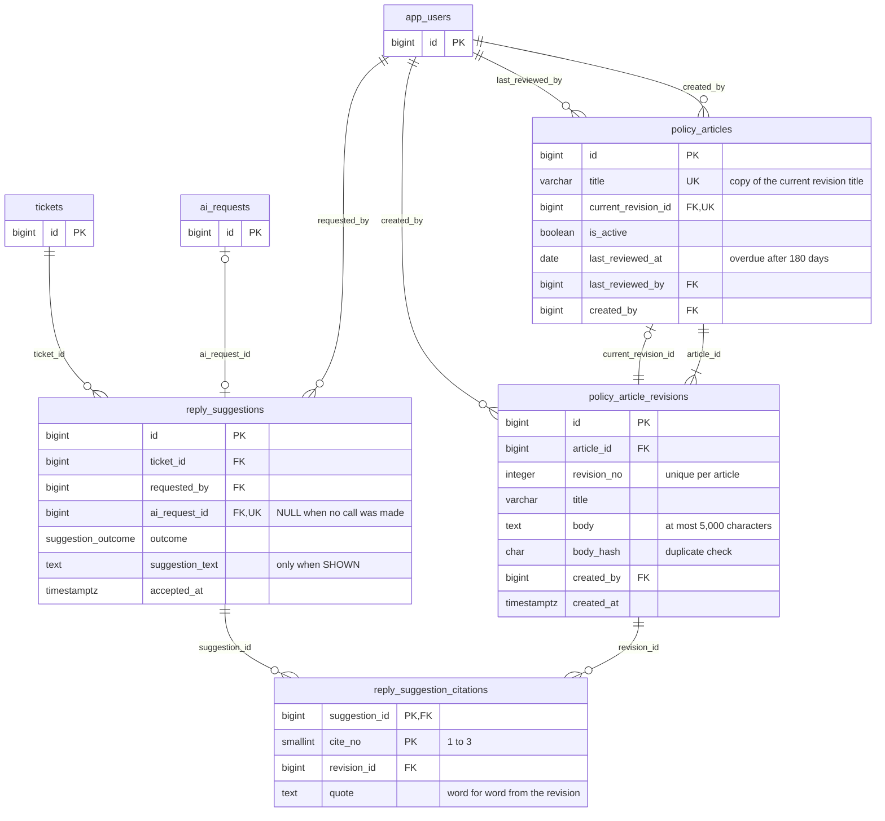

# ER Diagram

> Design status: MVP — Step 5 of 9, proposed
>
> Implementation status: NOT STARTED

The PostgreSQL schema of **Helpdesk AI** (D-28), drawn from [helpdesk_ai.dbml](helpdesk_ai.dbml). Table purposes, derived values, and transaction boundaries are in the [data model](01-data-model.md).

## Relationships (tables)

`app_users` is on the left because almost every table refers to it. The five groups are on the right. Arrows point from the referenced table to the table that refers to it.

## Enums

| Enum | Values | UI |
|---|---|---|
| `user_role` | CUSTOMER, STAFF, ADMIN | Khách hàng, Nhân viên hỗ trợ, Quản trị viên |
| `account_status` | ACTIVE, ON_LEAVE, LOCKED | Hoạt động, Đang nghỉ (Staff only), Đã khóa |
| `leave_end_reason` | ENDED_BY_ADMIN, ACCOUNT_LOCKED | Not shown; leave history |
| `ticket_status` | NEW, IN_PROGRESS, WAITING_FOR_CUSTOMER, RESOLVED, CLOSED | Mới, Đang xử lý, Chờ khách (customers see "Chờ bạn phản hồi", DF-22), Đã giải quyết, Đã đóng |
| `ticket_priority` | LOW, MEDIUM, HIGH, URGENT | Thấp, Trung bình, Cao, Khẩn cấp |
| `ticket_sentiment` | POSITIVE, NEUTRAL, NEGATIVE, ANGRY | Tích cực, Trung lập, Tiêu cực, Bức xúc |
| `classification_status` | PENDING, CLASSIFIED, UNCLASSIFIED | "AI đang phân loại…", the labels, "Chưa phân loại" |
| `unclassified_cause` | LOW_CONFIDENCE, AI_ERROR | The label panel explains which one |
| `email_status` | PENDING, SENT, FAILED | Not shown; email outbox |
| `ai_feature` | CLASSIFY, SUMMARIZE, REWRITE, SUGGEST_REPLY | Not shown; AI request log |
| `ai_outcome` | SUCCESS, INVALID_OUTPUT, TIMEOUT, ERROR | Not shown; AI request log |
| `suggestion_outcome` | SHOWN, NO_MATCH, POLICY_CHANGED, FAILED | The suggestion, "Không tìm thấy chính sách phù hợp", "Chính sách vừa được cập nhật…", the error with Retry |

## Detailed ER diagram — accounts, tickets, AI, notifications

At most one leave per Staff member is open at a time (partial unique index on `staff_id` where `ends_at` is NULL), and at most 5 attachments belong to a ticket (checked by the API).

## Detailed ER diagram — policies (D-25, D-26)

`app_users`, `tickets`, and `ai_requests` are shown with their key only; their columns are in the diagram above.

An article always has at least one revision, and exactly one of them is current. Revisions are only inserted. A citation points to the exact revision AI was given, so an old suggestion still shows the text it quoted after the article changes (D-26).

**Related:** [Step index](README.md)
