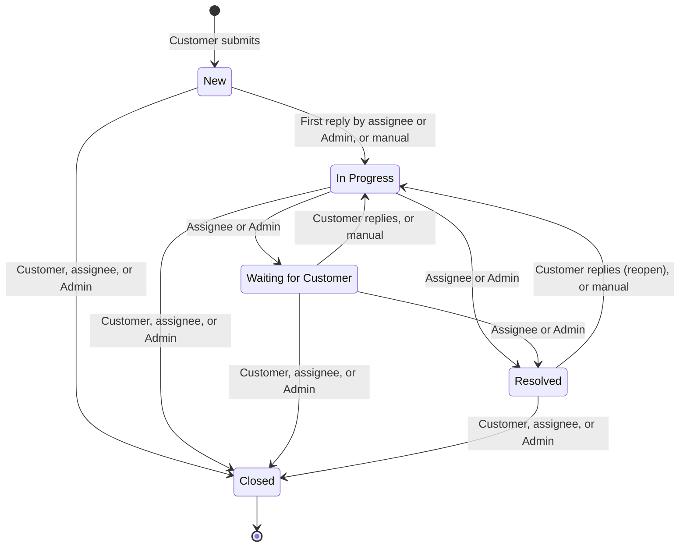

# Business Rules — Helpdesk AI MVP

> Design status: MVP — Step 2 of 9, approved
>
> Implementation status: NOT STARTED

Only rules confirmed by the project documentation are catalogued here. Values marked DF-xx are defaults pending confirmation; see [Step 2 defaults](../02-usecases-userstories/00-decisions.md#defaults-pending-confirmation). The Related API lines are filled in by Step 6.

## BR-01 — Roles

- **Source:** D-02, D-03 ([Step 1 decisions](../01-research/00-decisions.md)), DF-13
- **Related US:** US-01, US-04, US-30, US-31
- **Related API:** TBD (Step 6)
- **Rule:** The only roles are `CUSTOMER`, `STAFF`, and `ADMIN`. Admin has every Staff permission on all tickets, plus administration. Customers register themselves. Staff accounts are created by Admin. The first Admin account is created at installation.

## BR-02 — Visibility

- **Source:** D-09, DF-14, DF-15
- **Related US:** US-04, US-09, US-10, US-17, US-18, US-19
- **Related API:** TBD (Step 6)
- **Rule:**
  - A Customer sees only their own tickets and never sees priority, sentiment, confidence, AI reason, or the summary.
  - A Staff member sees and acts only on tickets **currently assigned to them**. After a transfer, the previous assignee loses access.
  - Admin sees and acts on all tickets, including Unassigned ones.
  - The server enforces these rules on every request.

## BR-03 — Auto-assignment

- **Source:** D-04, D-07, DF-01..DF-04
- **Related US:** US-07, US-11, US-13, US-32, US-36
- **Related API:** TBD (Step 6), triggered by submit ticket, lock account, set on leave, and customer reply (reopen when the assignee is locked or on leave)
- **Rule:** When a ticket is created, the system assigns it to the **active `STAFF` user with the fewest open tickets**.
  - Open means `New`, `In Progress`, or `Waiting for Customer`.
  - Ties go to the Staff member whose last assignment is the oldest.
  - Admin, locked users, and Staff on leave are never chosen (BR-18).
  - With no active Staff, the ticket stays Unassigned.
  - Assignment does not depend on the AI result.

## BR-04 — Transfer and reassignment

- **Source:** D-04
- **Related US:** US-22, US-23
- **Related API:** TBD (Step 6), including the list of active Staff
- **Rule:**
  - Staff may transfer a non-closed ticket assigned to them to another **active Staff** member, chosen from a list of active Staff with their open-ticket counts.
  - Admin may reassign any non-closed ticket (including Unassigned) to any active Staff member or to themselves.
  - A transfer does not change the ticket status.
  - "Active Staff" means status `Active`; Staff on leave or locked are not in the list (BR-18).

## BR-05 — Locked accounts

- **Source:** DF-05, DF-06, DF-13
- **Related US:** US-02, US-11, US-32, US-36
- **Related API:** TBD (Step 6)
- **Rule:**
  - A locked user cannot log in, and any existing session ends on its next request.
  - Locking a Staff member redistributes their open tickets using BR-03.
  - A reopened ticket whose assignee is locked or on leave is auto-assigned again.
  - Admin cannot lock their own account.

## BR-06 — Ticket status transitions

- **Source:** brief (ticket lifecycle), D-10, D-11
- **Related US:** US-11, US-12, US-20, US-21
- **Related API:** TBD (Step 6)
- **Rule:** Only the transitions below are allowed. `Closed` is final.

| # | From | To | Trigger | Who |
|---|---|---|---|---|
| T1 | — | `New` | Ticket submitted | Customer |
| T2 | `New` | `In Progress` | First reply (automatic, D-10) or manual | Assignee, Admin |
| T3 | `In Progress` | `Waiting for Customer` | Manual, usually with "Send and wait for customer" | Assignee, Admin |
| T4 | `Waiting for Customer` | `In Progress` | Customer replies (automatic) or manual | System, assignee, Admin |
| T5 | `In Progress`, `Waiting for Customer` | `Resolved` | Manual | Assignee, Admin |
| T6 | `Resolved` | `In Progress` | Customer replies (automatic reopen, D-11) or manual | System, assignee, Admin |
| T7 | Any except `Closed` | `Closed` | Manual | Customer (own), assignee, Admin |

## BR-07 — Replies

- **Source:** brief, D-10
- **Related US:** US-11, US-20
- **Related API:** TBD (Step 6)
- **Rule:**
  - A Customer can reply to their own ticket unless it is `Closed`.
  - Staff and Admin can reply to tickets they can act on, unless `Closed`.
  - The **first reply by the assignee or Admin** sets the first response time and triggers T2.
  - Any new message marks an existing summary as outdated (BR-11).
  - A reply by Staff or Admin sends the customer a notification email (BR-17).

## BR-08 — AI classification

- **Source:** brief (AI design 1), A-05, DF-07..DF-09
- **Related US:** US-07, US-14, US-15, US-16
- **Related API:** TBD (Step 6), triggered by submit ticket
- **Rule:**
  1. Runs once per ticket, after the ticket is saved, using **one** LLM call.
  2. Input: title, description, and the active categories (name and description). Attachments are never sent.
  3. Output: JSON with `category`, `priority` (`low` / `medium` / `high` / `urgent`), `sentiment` (`positive` / `neutral` / `negative` / `angry`), `confidence` (0–1), and `reason`.
  4. If the customer chose a category, it is kept; AI sets only priority and sentiment.
  5. The output must match the schema, the enums, and the active category list. Any other field is ignored. Invalid output counts as a failure.
  6. If `sentiment` is `angry`, priority is raised one level (`low` → `medium` → `high` → `urgent`; `urgent` stays `urgent`).
  7. If confidence is below the threshold (default 0.6), or the call fails or times out (default 10 s), the AI-set labels become **"Unclassified"**. If the customer chose the category, only priority and sentiment become Unclassified. There is no automatic retry.
  8. Ticket creation never waits on AI and never fails because of it.

## BR-09 — AI label and final label

- **Source:** brief ("store the AI's original label and the final label")
- **Related US:** US-14, US-19, US-24
- **Related API:** TBD (Step 6)
- **Rule:**
  - The **AI label** is stored once and never overwritten. It holds the category (if AI chose it), the priority after rule 6, the sentiment, the confidence, and the reason.
  - The **final label** starts equal to the AI label and changes only when Staff or Admin correct it.
  - An Unclassified ticket needs a human to set its category and priority.

## BR-10 — Label correction rate

- **Source:** D-12
- **Related US:** US-24, US-33, US-34
- **Related API:** TBD (Step 6)
- **Rule:**
  - **Denominator:** tickets in the period whose AI classification succeeded (not Unclassified).
  - **Numerator:** among those, tickets where *(AI chose the category **and** final category ≠ AI category)* **or** *(final priority ≠ AI priority)*.
  - **Rate** = numerator ÷ denominator.
  - Sentiment corrections are not counted. Unclassified tickets are excluded; they are measured by G-05.

## BR-11 — AI summary

- **Source:** brief (AI design 2), DF-09
- **Related US:** US-25
- **Related API:** TBD (Step 6)
- **Rule:**
  - Input: the original description and all replies.
  - Output: 3–4 lines covering the main issue, what has been done, and what is pending.
  - The latest summary is stored with its generation time. If any message is newer, the summary is marked **Outdated** and can be regenerated; regenerating replaces it.
  - The timeout is 20 s.
  - Only Staff and Admin can see summaries.

## BR-12 — AI reply rewrite

- **Source:** brief (AI design 3), DF-09
- **Related US:** US-20, US-26
- **Related API:** TBD (Step 6)
- **Rule:**
  - Input: the draft and the ticket context.
  - Output: a polite, clear reply with the same meaning and information. It must add **no new commitments, dates, amounts, or numbers**.
  - The rewrite is only placed in the reply box. **Nothing is sent without an explicit Send click.**
  - The timeout is 20 s.

## BR-13 — Categories

- **Source:** brief (category management), DF-18
- **Related US:** US-07, US-27, US-28, US-29
- **Related API:** TBD (Step 6)
- **Rule:**
  - A category has a name (required, unique ignoring case) and a description (required, because AI uses it as context).
  - A hidden category disappears from the customer form, the AI category list, and the label-correction choices. Existing tickets keep it, and filters still show it.
  - Categories are never deleted.

## BR-14 — Attachments

- **Source:** brief (submit form), A-05, DF-10
- **Related US:** US-08
- **Related API:** TBD (Step 6)
- **Rule:**
  - Attachments are allowed only when submitting a ticket: up to 5 files, 10 MB each, of type `jpg`, `jpeg`, `png`, or `pdf`.
  - Only the ticket owner, the assignee, and Admin can see them.
  - They are never sent to the LLM.

## BR-15 — Accounts and passwords

- **Source:** brief (authentication, profile), DF-11, DF-12
- **Related US:** US-01, US-02, US-05, US-06, US-31
- **Related API:** TBD (Step 6)
- **Rule:**
  - Email is unique and is the login name.
  - Passwords have at least 8 characters.
  - Changing a password requires the current password.
  - In the profile, only full name and phone are editable; email and role are read-only.

## BR-16 — Dashboard metrics

- **Source:** brief (dashboard), D-08, DF-17
- **Related US:** US-33, US-34
- **Related API:** TBD (Step 6)
- **Rule:**
  - **Range:** the last 30 days by creation date, unless the user picks another range.
  - **Counts:** tickets by status, by final category, and by final sentiment, with Unclassified as its own group.
  - **Average first response time:** the mean of (first reply by the assignee or Admin − creation time) over tickets in the range that have a reply. Tickets still waiting for a first reply are shown as a separate count.
  - **Label correction rate:** see BR-10.
  - **Scope:** Admin sees all tickets. Staff see only the tickets currently assigned to them.

## BR-17 — Customer email notifications

- **Source:** D-19, DF-25
- **Related US:** US-35
- **Related API:** TBD (Step 6), triggered by reply to customer and change status
- **Rule:**
  - The customer of a ticket gets an email when Staff or Admin **reply** to it or **change its status** (any transition in BR-06 made by them).
  - One action sends **at most one email**. A reply that also changes the status ("Send and wait for customer", or the first reply that triggers T2) sends one email.
  - No email for the customer's own actions, automatic transitions caused by them (T4, T6), transfers, reassignments, or label corrections.
  - No email when the customer account is locked.
  - Content follows DF-25: ticket number, title, what changed, and a link to the ticket. The reply text is not included.
  - Sending happens after the action is saved. A failed send is logged and **never blocks or undoes** the reply or status change.

## BR-18 — Staff on leave

- **Source:** D-20, DF-26
- **Related US:** US-13, US-22, US-23, US-36
- **Related API:** TBD (Step 6), set on leave and end leave
- **Rule:**
  - Account status is `Active`, `On leave`, or `Locked`. `On leave` exists only for `STAFF` accounts.
  - **Only Admin** can set a Staff member on leave or end their leave. Staff cannot change their own status; the server rejects such a request.
  - Only an `Active` Staff account can be set on leave. Setting it redistributes all their open tickets with BR-03; ending leave sets `Active` and does not move tickets back.
  - A Staff member on leave is never auto-assigned and never offered as a transfer or reassign target. They can still log in and see only the tickets still assigned to them (BR-02).
  - An on-leave account can be locked; unlocking returns it to `Active`.
  - Setting or ending leave sends no email to customers (BR-17). [Use cases and user stories](../02-usecases-userstories/README.md) · [Master traceability](../traceability/master-traceability.md)
